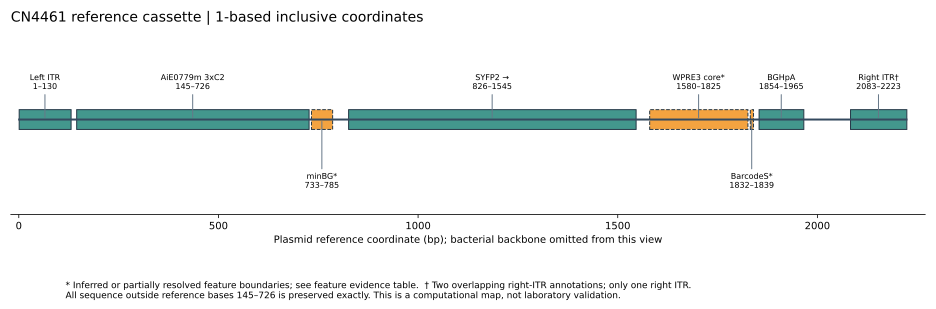
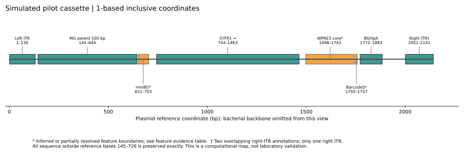

# CN4461 verification and small-pilot design

November 10, 2026. **Decision: proceed to technical review of the pilot design.**
The exact enhancer replacement is verified independently of restriction sites.
Three illustrative parents pass computational sequence checks. Some named
feature boundaries remain inferred. This is not an order or laboratory validation.

## Reference and enhancer identification

Source of truth: official **CN4461, Addgene #236600, sequence 472831**, 4,820-bp
circular DNA. Native GenBank and SnapGene nucleotide sequences agree exactly.
Sequence SHA256:
`d307c7f1e22e2e81eb939cebfe671d836e346c6f06ef2a73414244aa027514c0`.
Unchanged native files are in `../reference/`.

Related **CN3044, Addgene #191706, sequence 379462**, is 4,808 bp. Its two native
formats also agree. Whole-plasmid alignment at the same origin/orientation:

| CN4461 | CN3044 | Result |
|---|---|---|
| 1–1827 | 1–1827 | Exact identity |
| 1828–1839 | Gap | Additional `CGAGAGCAATTA` at barcode junction |
| 1840–4820 | 1828–4808 | Exact identity |

**Hunker et al., Table S1, row 30**, provides the complete 582-bp synthetic
AiE0779m_3xC2 sequence for AiP13044/CN3044. It matches **CN4461 145–726 exactly,
582/582 bp**, and the same interval in CN3044. Three identical 194-bp copies
occupy **145–338, 339–532 and 533–726**, with no intervening spacer. This proves
the enhancer interval independently of the cloning sites. The extracted row,
sequence and alignment are saved in this folder.

## Feature annotations and confidence

Coordinates are **1-based inclusive on the CN4461 reference**. Expression is
on the plus strand. ITR plus signs describe the source-map orientation, not a
directional transcript. Downstream pilot coordinates are reference minus 82 bp.

| Feature | Reference interval | Strand | Supporting evidence / limit |
|---|---|---|---|
| Left AAV2 ITR | 1–130 | + map, inverted repeat | Native alternate 130-bp ITR annotation; not assumed to be canonical wild-type 145 bp. |
| AiE0779m_3xC2 | 145–726 | + | Exact published 582-bp sequence and three identical C2 copies. |
| minBG candidate | 733–785 | + | Strong inference: Table S1 specifies beta globin, 53 bp; conserved 53-bp interval after SacI and before BamHI. Independent base-resolved minBG annotation absent. |
| SYFP2 CDS | 826–1542 | + | Native joined feature is contiguous, 717 nt; translation exactly matches native 239-aa annotation, without internal stops. |
| SYFP2 stop | 1543–1545 | + | Exact TAA immediately after annotated CDS, retained. |
| WPRE3 aligned core | 1580–1825 | + | Exact 246-bp match to original Choi CW3B GenBank KJ411912.1 bases 1301–1546. Published nominal size is 247 bp; terminal-base inclusion unresolved. |
| BarcodeS candidate | 1832–1839 | + | AGCAATTA, 8 bp immediately before published barcode readout pattern. Strong inference; original barcode-name-to-sequence table not supplied. |
| BGHpA signal | 1854–1965 | + | Native bGH poly(A) annotation; exact match to CN3044 1842–1953. Not asserted to delimit the whole functional processing region. |
| Right AAV2 ITR | 2083–2223 or 2083–2212 | + map, inverted repeat | Overlapping native 141-bp and 130-bp annotations for ONE right ITR; endpoint convention unresolved. Both intervals retained. |

`feature_evidence.tsv` and `.fasta` provide exact feature/protected-interval
nucleotides, SHA256, confidence and shifted pilot coordinates. The annotated
GenBank preserves native features and labels added inferences explicitly.

The 53-bp minBG candidate sequence is:

```text
GGGCTGGGCATAAAAGTCAGGGCAGAGCCATCTATTGCTTACATTTGCTTCTG
```

Hunker describes 8-bp barcodes and the readout pattern `(BC)CGAGAGATCTTCGAC`.
CN4461 has:

```text
1826–1831       1832–1839       1840–1854
CTCGAG          AGCAATTA        CGAGAGATCTTCGAC
XhoI flank      candidate S    downstream readout pattern
```

The final C overlaps the native BGHpA annotation. All bases are retained.
The **12-bp alignment insertion is not a 12-bp barcode**: four repeated junction
bases accompany the inferred 8-bp barcode, and equivalent gap placements are
possible. No new barcode has been assigned.

To avoid relying on uncertain endpoints, checks preserve the entire **733–825
promoter/linker region**, **1546–1831 WPRE/linker region**, **1826–1854 barcode
junction**, downstream polyA context through 2082, both ITR annotation extents,
and every other non-enhancer reference base.

## Recognition sites, staggered cleavage and replacement

One site per enzyme was found by circular scanning and independently checked
with Biopython's restriction definitions:

| Enzyme | Recognition site | Plus-strand cut | Opposite-strand cut in reference-coordinate system |
|---|---|---|---|
| MluI | 139–144 | A/CGCGT, after 139 | After 143; 4-nt 5′ CGCG overhang |
| SacI | 727–732 | GAGCT/C, after 731 | After 727; 4-nt 3′ AGCT overhang |

Digestion removes plus-strand **140–731, 592 nt**, not just the 582-bp enhancer.
The retained backbone plus strand is **732–4820 followed by 1–139**, 4,228 nt.
The synthesis flanks below restore both complete recognition sites. The final
sequence is exactly:

```text
CN4461[1–144] + forward 500-bp MG parent + CN4461[727–4820]
```

**MluI/SacI are appropriate for replacing this enhancer.** The published enhancer
is fully removed, while all reference sequence outside 145–726 is unchanged in
the assembled design. No promoter, reporter, WPRE, barcode, polyA or ITR base
outside that independently established interval is removed. The 82-bp shortening
is entirely within the replaced enhancer, not its downstream linker.

## Homology assembly and exact synthesis format

Recommended design: **two-fragment NEBuilder HiFi-type assembly** using a
separately MluI/SacI-linearized backbone and synthetic double-stranded insert.
This avoids whole-backbone PCR through ITRs. **Do not restriction-digest the
synthetic insert.** Both flanks below are written 5′→3′ in the final construct
direction; append the right flank as shown, without reverse-complementing it.

| Common flank | Reference source | Length |
|---|---|---|
| GTTCCTGCGGCCGCACGCGT | 125–144 | 20 bp |
| GAGCTCGGGCTGGGCATAAAAGTCAGGGCA | 727–756 | 30 bp |

```text
5′–[20-bp left flank]–[500-bp parent]–[30-bp right flank]–3′
                          total: 550 bp
```

Accounting for the cuts, **15 bp** of the left flank match retained plus-strand
125–139 and **25 bp** of the right flank match retained 732–756. The other five
bases per flank restore restriction-site sequence. Predicted overlap Tm values
are **54.5°C and 63.2°C** using saved Biopython DNA_NN3 defaults (25 nM each
strand, 50 mM Na, no Mg correction). NEB recommends at least 15-nt overlaps and
Tm ≥48°C. These estimates do not establish assembly efficiency.

Each complete arm has one intended exact reference match and no complete
reverse-complement match. The left arm includes six terminal left-ITR bases;
its longest exact tract elsewhere is 14 bp, versus 24 bp for the initial longer
arm. Shortening reduces shared ITR homology. The right arm's longest tract
elsewhere is 8 bp. The other ITR is internal to the retained backbone, not an
intended free end. Secondary structure, internal recombination and parental
background remain laboratory considerations despite full-arm uniqueness.

## Simulated examples and vector lengths

Three **provisional natural parents**, original ranks 140/PRSS56, 25/ADGRA2 and
779/TNRC17 from the prior activity-oriented shortlist, illustrate the design.
This is not a final pilot selection and does not authorize synthesis.

| Parent rank | Insert | Synthesis fragment | Plasmid | Internal MluI / SacI |
|---|---|---|---|---|
| 140 | 500 bp | 550 bp | 4,738 bp | 0 / 1; SacI starts at insert base 392 |
| 25 | 500 bp | 550 bp | 4,738 bp | 0 / 0 |
| 779 | 500 bp | 550 bp | 4,738 bp | 0 / 0 |

Parent 140's internal SacI is compatible with **separate backbone digestion**,
but invalidates an assumption of one SacI site in the completed plasmid. Do not
digest that insert or use an unchanged two-site diagnostic-digest expectation.
GC fractions are 62.8%, 62.0%, 48.0%; maximum homopolymers are 5, 6, 4 nt.

For each example, independent directed overlap reconstruction on the actual
restriction-cut plus strand exactly reproduced the intended circular plasmid.
Checks passed: one intended insert, supplied orientation relative to SYFP2,
no intact original 194-bp C2 repeat, all native feature sequences retained,
and **every base outside 145–726 unchanged**. Overlaps are resolved once, not
duplicated. Per-example QC and exact sequences are in `pilot_review_only/`.

- Whole plasmid: **4,820 − 582 + 500 = 4,738 bp**.
- ITR-to-ITR span including both long-annotated repeats: **2,141 bp**, pilot 1–2141.
- Alternative short right-ITR endpoint: **2,130 bp**, pilot 1–2130; an annotation
  alternative, not a second genome.
- Sequence strictly between the repeats: **1,870 bp**, pilot 131–2000.

These are digital reference spans, not measured packaged-genome lengths or
proof of packaging performance. No filler or other sequence was added.





## Unresolved evidence and physical verification

Obtain the **base-annotated depositor CN4461 map**, **BarcodeS oligo/name table**
and precise minBG/WPRE3 element definitions from Allen/Ting or Addgene support.
These should resolve named endpoints without guessing. Request the intended
right-ITR endpoint and compare physical stock using ITR-aware sequencing.
Do not silently replace its alternate ITR with consensus sequence.

Pilot-clone QC should establish both junctions, full insert, barcode, reporter
cassette and physical ITR integrity, and exclude residual parental enhancer.
Whole-plasmid sequencing plus appropriate ITR-aware checks provides more
coverage than insert-only Sanger reads. Digital identity cannot establish ITR
folding, reaction success, reporter specificity, genome packaging or expression.

**The identical preserved BarcodeS cannot distinguish these parents in a pooled
barcode assay.** The package supports sequence review and separate pilot
handling. Pooling for barcode attribution needs a verified parent–barcode plan;
no pooled-library design is released here.

## Reproducibility and sources

`verification_summary.json`, `run_parameters.json`, output `checksums.sha256`,
reference `all_reference_checksums.sha256`, and per-feature/per-construct hashes
record the checks and provenance. Reproduce from repository root with:

```bash
MPLCONFIGDIR=/tmp/cn4461-matplotlib .venv/bin/python scripts/verify_cn4461_pilot.py
```

Requirements: Biopython 1.85 and Matplotlib. Assertions stop on disagreement.
The fragment manifest is explicitly marked **REVIEW_ONLY_NOT_AN_ORDER**.

1. [CN4461 official sequences](https://www.addgene.org/236600/sequences/), sequence 472831; downloaded through the authenticated browser November 9, 2026.
2. [CN3044 official sequences](https://www.addgene.org/191706/sequences/), sequence 379462; same acquisition date.
3. [Hunker et al., Neuron 2025](https://pmc.ncbi.nlm.nih.gov/articles/PMC12237622/), DOI 10.1016/j.neuron.2025.04.035; Table S1 row 30 and construct/barcode methods. XML and unchanged workbook saved locally.
4. [Choi et al., Molecular Brain 2014](https://pmc.ncbi.nlm.nih.gov/articles/PMC3975461/), DOI 10.1186/1756-6606-7-17; [original CW3B accession KJ411912.1](https://www.ncbi.nlm.nih.gov/nuccore/KJ411912.1). Primary deposits KJ411911–KJ411919 saved locally.
5. [NEB cleavage definitions](https://www.neb.com/en/tools-and-resources/selection-charts/alphabetized-list-of-recognition-specificities).
6. [NEBuilder HiFi manual](https://www.neb.com/-/media/nebus/files/manuals/manuale2621_e5520.pdf), restriction-vector overlaps and restoration of recognition sites.
