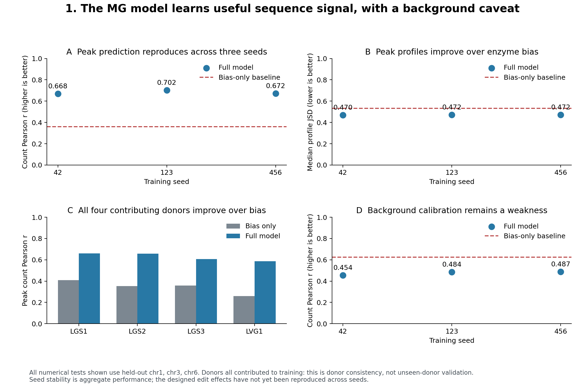
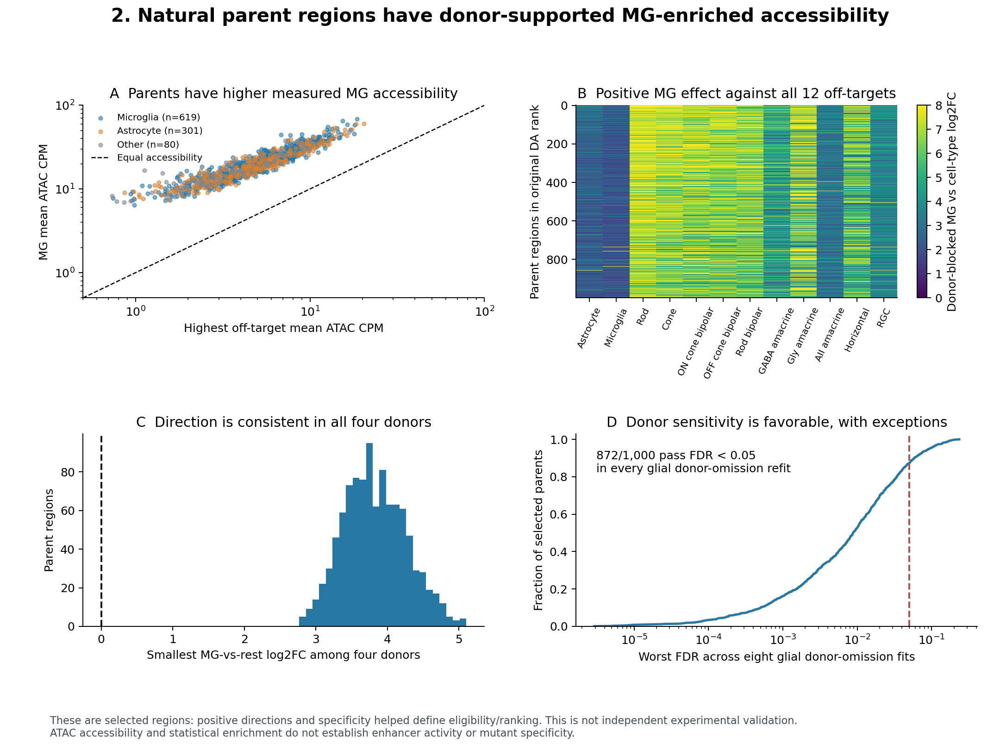
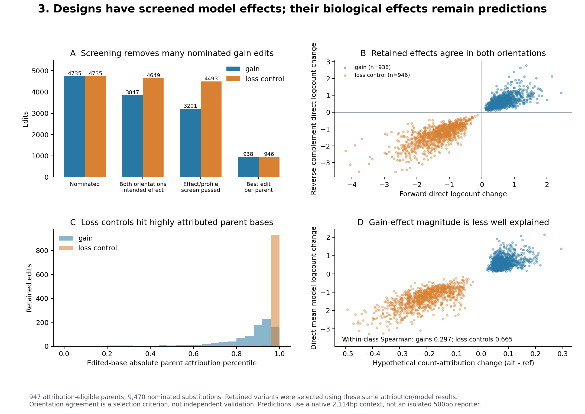
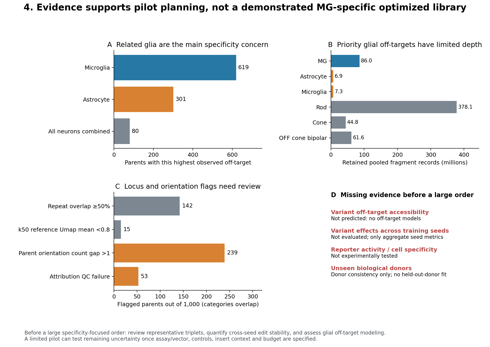

# Evidence review before ordering an experimental library

Prepared for the October 14, 2026 discussion with Thanh. This is an assessment of existing results, not a new validation run.

**Recommendation: GO for planning a controlled pilot; insufficient evidence for a large order justified as specificity-optimized variants.** We have useful MG sequence models, donor-supported parent-region enrichment and screened predicted edits. We do not yet have off-target variant predictions, cross-seed edit stability or reporter validation. Figures should support an informed decision about those uncertainties rather than imply that computational predictions guarantee experimental success.

Open **`evidence_review.html`** in a browser. It embeds all four figure sheets and can be shared as one standalone file. PNGs are suitable for discussion and SVGs for editing or presentations. All plots have numerical exports and a source-checksum manifest. No private cluster connection settings are needed to view this report.

```bash
open reports/decision_review/evidence_review.html
```

## 1. Is the MG model learning useful signal?



On held-out chromosomes 1, 3 and 6, peak count Pearson is 0.668–0.702 across three seeds, compared with 0.359 for the enzyme-bias baseline. Median peak-profile JSD is 0.470–0.472 versus 0.534 for bias; lower is better. Every contributing donor has better peak count prediction than the matched bias baseline (full model r = 0.587–0.661).

The background count correlation is worse than bias for all three seeds. Absolute prediction calibration and background inflation remain concerns. These charts show aggregate held-out chromosome performance, not independent validation of the designed sequences. All four donors contributed to training; donor evaluation does not establish generalization to an unseen donor.

## 2. Are the natural parents MG-enriched and donor-supported?



All 1,000 selected natural parents have positive MG effects against each of the 12 retinal off-target types. The smallest donor-specific MG-vs-rest effect remains positive in every parent. In 872/1,000 parents, FDR is below 0.05 in all eight astrocyte/microglia donor-omission refits.

These are selected parents: effect direction, reproducibility and specificity were used in eligibility/ranking, so this is a description and sensitivity assessment of the selection, not an independent test of it. Accessibility enrichment does not establish reporter activity, enhancer function, or the specificity of a designed mutant.

## 3. Do the designed edits have consistent predicted effects?



The full scan considered 4,735 gain nominations and 4,735 loss-control nominations across 947 attribution-eligible parents. Both-orientation direction agreement retained 3,847 gains and 4,649 loss controls. Effect/profile screening retained 3,201 and 4,493 substitutions; selecting one passing edit per parent and class gives 938 gains and 946 loss controls.

Retained effects agree in both orientations because that was a selection requirement. Likewise, parent attribution nominated the substitutions, so attribution agreement is not independent validation. Within selected classes, hypothetical attribution change versus direct predicted logcount change has Spearman 0.297 for gains and 0.665 for loss controls. Gain-effect magnitudes therefore have weaker attribution support. Model predictions use the insert inside its native 2,114bp sequence context; isolated 500bp reporter results can differ.

## 4. What could still invalidate the intended interpretation?



Astrocytes or microglia are the highest measured off-target for **920 of 1,000 natural parents**. These types have only 6.9M and 7.3M retained pooled fragments, versus 86.0M for MG. Their model feasibility needs direct assessment; plentiful rod data would not by itself address the main glial specificity concern.

Other locus flags remain visible: 142 parents have at least 50% repeat overlap, 15 have low mean reference k50 Umap (<0.8), 239 have a forward/reverse parent count gap exceeding one log unit, and 53 failed attribution QC. Categories overlap and flags are not automatic exclusions. The 53 attribution failures have natural-parent entries but no proposed variants. Reference mappability is not mutant mappability, and repeat overlap alone does not prove a sequence is unusable.

The key missing evidence is:

1. **Variant stability across the existing three seeds.** Similar aggregate performance does not imply identical mutation effects. Re-score parents and mutants with the other two checkpoints before calling the designs robust across models.
2. **Off-target sequence predictions, especially related glia.** Assess astrocyte/microglia training feasibility and appropriately depth-supported neuronal models; then compare parent-to-variant changes within each model. Do not naively subtract uncalibrated absolute outputs from independently trained cell-type models.
3. **Assay-relevant review and a controlled pilot.** Inspect representative parent/gain/control triplets, assay controls and insert context. Reporter activity and cell-type specificity need experimental testing. No amount of these existing in-silico consistency figures can establish those outcomes in advance.

A large specificity-focused order should not be justified solely by the current MG gain predictions. A limited pilot can be an experiment to resolve uncertainty, provided Thanh agrees on its assay, controls, budget and decision criteria. No synthesis subset, vector order or new cluster job was initiated by this review.

## Reproduction and provenance

```bash
MPLCONFIGDIR=/tmp/glia-matplotlib .venv/bin/python scripts/build_decision_evidence_figures.py
```

- `source_checksums.json`: exact input file hashes.
- `model_seed_evidence.csv`, `model_donor_evidence.csv`: numerical model panels.
- `parent_specificity_evidence.csv`: the 1,000 natural-region observations.
- `variant_screen_evidence.csv`, `variant_effect_evidence.csv`: selection counts and mutation predictions.
- `evidence_summary.json`: the main numerical findings and scoped recommendation.
- `output_checksums.sha256`: the generated review artifacts.

Older stage reports may say later phases are blocked because they document historical checkpoints. This review uses the subsequent completed donor, seed, DA and variant results; it does not reopen those historical stage gates.
